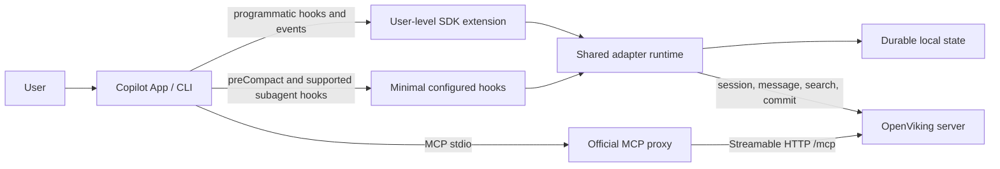

# Design overview

## 1. Status

This document is the approved implementation design. The local SDK extension,
runtime, and configured `preCompact` command are implemented and unit-tested.
The command has been smoke-tested with memory disabled in an isolated Copilot
home. A signed-in isolated CLI completed a real `/compact`, and a metadata-only
probe observed `preCompact`. In a follow-up isolated run, the installed command
returned exit code 0 in 130 ms and 148 ms and completed before the host's
compaction-complete event; memory was disabled, so the hook correctly skipped
remote work. A read-only OpenViking MCP `health` call also succeeded with
automatic memory behavior disabled. A restricted memory-enabled `preCompact`
run committed one synthetic peer-only preference and cleaned its session and
generated artifacts. A follow-up metadata-only audit captured the successful
hook result and exit code 0, with no watchdog, 8.414 seconds before the host's
compaction-complete event. The server's `last_commit_at` timestamp was later
than that event, so command completion must be measured independently. This
established ordering for that invocation. A later isolated CLI `1.0.90`
compaction matched two eligible transcript events to durable digests and
committed to a loopback-only simulator before Hook end and host compaction
completion. This establishes the transcript-visible durable-prefix gate for
the tested host run; a general transcript-delivery guarantee and unrestricted
memory activation remain outside that evidence.

Evidence levels used throughout the design:

- **Verified**: confirmed in installed Copilot SDK types/docs or OpenViking docs/source.
- **Experiment required**: the API exists, but timing, ordering, or real-host behavior
  must be measured before implementation is accepted.
- **Unsupported**: the current host cannot provide the required contract.

## 2. Design goals

### Functional

1. Automatically load durable user and project context at session start.
2. Recall prompt-specific context with `search(mode="context")`.
3. Capture normalized user, assistant, and tool records incrementally.
4. Commit a consistent prefix of captured activity before context compaction and
   on session end.
5. Preserve OpenViking's full active MCP tool surface.
6. Guard `viking://` URIs from accidental use by local filesystem tools.
7. Provide health, status, and actionable diagnostics.

### Quality

- Fail open for memory availability: OpenViking failure must not disable Copilot.
- At-least-once transport with idempotent local event identity.
- Never advance a durable cursor before the corresponding record is accepted or
  durably queued.
- Bounded recall latency and bounded injected context.
- One configuration and credential path for automatic behavior and MCP tools.
- No secrets or full conversation payloads in ordinary logs.

### Non-goals for version 1

- Replacing Copilot's own context compaction.
- Reimplementing OpenViking MCP tools inside the extension.
- Supporting cloud agents as if they shared the local extension runtime.
- Capturing hidden reasoning or Copilot system prompts.
- Guaranteeing independent memory injection for every built-in subagent.

## 3. Architecture

### 3.1 Copilot SDK extension

The extension is the primary coordinator because it has a persistent process,
programmatic hooks, event history, and dynamic MCP registration.

Responsibilities:

- Load configuration and establish workspace/peer identity.
- Join the foreground Copilot session.
- Dynamically register the OpenViking MCP proxy.
- Run startup context injection and prompt-time recall.
- Observe and normalize session events.
- Drive capture, queue replay, commit, and recovery.
- Apply URI guards and expose diagnostic status.

It must not own irreplaceable state only in memory. Copilot can reload the
extension when the foreground session changes or `/clear` creates a new session.

### 3.2 Minimal configured hook

The configured hook exists only where the SDK lacks a blocking lifecycle point.

Implemented responsibility:

- `preCompact`: flush records already present in the durable session journal,
  then commit only after the queue is fully accepted and within a bounded
  deadline.

Optional responsibility after host experiments:

- `subagentStart` and `subagentStop` for subagent types that actually emit those
  configured hooks.

The hook calls the same shared adapter runtime or a small local control endpoint.
It must not duplicate configuration, HTTP, queue, or message-conversion logic.
The current command starts a short-lived runtime against the same per-session
store and uses an interprocess lease to serialize remote flush/commit operations.
It does not import an SDK event still buffered in memory. A transcript audit
compares every eligible event visible through the Hook's compaction boundary
against durable source-ID and payload digests, blocking commit if a match is
absent. One isolated real-host run verified this gate and its ordering; a host
guarantee that all events have reached the transcript before the Hook is
unavailable.

### 3.3 OpenViking MCP proxy

The extension registers the official OpenViking stdio-to-HTTP proxy with
`joinSession({ mcpServers })`.

Reasons:

- Server tools remain the source of truth.
- New or changed tools do not require extension releases.
- Existing credential reload, MCP session recovery, SSE, and concurrency behavior
  can be reused.
- Automatic memory behavior and active tools resolve the same server identity.

### 3.4 Shared adapter runtime

Implementation should consume or vendor the upstream
`examples/memory-plugin-shared` modules with a small Copilot host adapter.

Required shared capabilities:

- configuration and credentials;
- workspace peer derivation;
- recall and profile injection;
- event/message conversion;
- batch send and pending queue;
- commit ordering;
- MCP proxy setup;
- URI guards;
- diagnostics.

The pinned upstream modules are now vendored under
`vendor/openviking-memory-plugin-shared/` with their original LICENSE, source
commit, and SHA-256 manifest. The runtime now consumes upstream configuration,
HTTP, peer-resolution, capture-sanitization, retry, profile, and recall helpers.
The OpenViking session adapter and Copilot SDK hooks are wired and tested with
mocked HTTP. The official stdio-to-HTTP MCP proxy is registered by the extension
after installation, and ownership-checked install/uninstall scripts copy only
the runtime files needed by the extension. The Copilot pre-tool hook uses the
shared URI guard to deny local filesystem paths under `viking://` while leaving
OpenViking MCP calls and shell commands available.

If upstream modules are not package-stable, vendored files must retain provenance
and a documented update procedure. Forking the behavior without reuse is rejected.

## 4. Lifecycle mapping

| Copilot lifecycle | Adapter action | OpenViking action | Timing |
|---|---|---|---|
| Extension load | Load config and state | Health/config validation | Non-blocking |
| `onSessionStart` | Resolve workspace and recover state | Create/resume session; replay queue; read profile/index/skills | Bounded blocking injection |
| `onUserPromptSubmitted` | Recall relevant context | `search(mode="context", session_id=...)` | Short bounded blocking |
| `user.message` | Normalize source message | Stage message | Async |
| tool start/complete | Correlate structured tool parts | Stage tool call/result | Async |
| `assistant.message` / turn end | Finalize assistant turn | Send consistent event prefix | Async |
| `onAgentStop` | Reconcile with event history/transcript | Flush current turn | Bounded |
| `preCompact` | Flush durable observed head | Commit only after a complete queue flush | Blocking with deadline |
| compaction complete | Refresh archive marker if needed | Read committed archive metadata | Async |
| `onSessionEnd` | Final reconcile and shutdown marker | Flush, commit, persist state | Bounded |
| Next startup after crash | Detect unclean state | Replay queue and reconcile history | Before normal capture |

## 5. Automatic context versus active tools

Automatic injection is intentionally conservative:

- Startup: profile, compact memory indexes, skill catalog, and recovery notices.
- Prompt time: only ranked context for the current prompt.
- Never inject raw L2 content without a retrieval decision and budget check.

Active MCP tools are used when the agent needs to:

- navigate OpenViking paths;
- read detailed L2 content;
- deliberately remember, edit, or forget information;
- add a resource or skill;
- inspect health or watches.

Automatic capture records the conversation. It does not replace explicit
`remember` when the agent or user wants to persist a precise fact immediately.

## 6. Session and peer identity

Three identities remain separate:

| Identity | Meaning | Lifetime |
|---|---|---|
| Copilot session ID | Source conversation and recovery partition | One Copilot session |
| OpenViking session ID | Message archive and memory extraction unit | Mapped 1:1 by default |
| OpenViking peer ID | Durable project/person context owner | Across many sessions |

Default peer resolution reuses OpenViking's Git-origin derivation. A non-Git
folder does not silently become a peer; it uses user memory unless explicitly
configured in `.openviking/config.json`.

## 7. Subagents

Subagent capture is an explicitly enabled local extension capability; it
remains disabled by default:

- Parent lifecycle events remain in the parent OpenViking session. When
  `OPENVIKING_COPILOT_SUBAGENT_MEMORY=true`, SDK child messages and supported
  tool events route to a separate session per child and commit on the observed
  `subagent.completed` boundary. The SDK stream must be enabled explicitly for
  that mode; the normal default does not subscribe to child streaming.
- The child session uses only peer preference memory, with self memory,
  working memory, and server-side auto-commit disabled. Its exact policy is
  verified before any message is sent. The feature currently captures memory
  but does not inject context into the child prompt.
- The parent/child mapping is kept locally using a SHA-256 hash of the Copilot
  agent ID. The server has no documented parent-session field or
  agent-attribution field, so remote archives cannot represent lineage.
- On process recovery, active children are conservatively marked `orphaned`;
  a process interrupted during commit is marked `commit_unknown`. Neither is
  committed or retried automatically. Diagnostics report these states without
  exposing raw agent IDs; manual recovery remains future work.
- Copilot CLI 1.0.90-7 fired configured `subagentStart` and `subagentStop`
  hooks for synthetic read-only fleet tasks. Across two two-child parallel
  runs, distinct opt-in `subagentStart` `additionalContext` markers reached the
  children; marker hashes correlated one-to-one with stop response hashes, and
  each stop `agentId` hash matched a child `userPromptSubmitted.sessionId`
  hash. In two authenticated interactive runs, the SDK extension joined the
  parent session and observed two each of `subagent.started`,
  `subagent.configured`, and `subagent.completed`, plus ephemeral assistant
  streaming events. In the latest run, lifecycle `agentId` hashes matched the
  stop-hook and child prompt-session hashes for both children. Each child also
  emitted one non-ephemeral `user.message` and one `assistant.message` with
  its matching `agentId`; this synthetic pair does not establish complete
  child/tool-event capture. In that run, `subagent.started` preceded each
  child's `user.message`, and `assistant.turn_end` preceded
  `subagent.completed`.   The start payload itself still omitted child identity. This is repeated
  evidence on CLI 1.0.90-7, not a general cross-version identity or recovery
  guarantee. Independent capture is therefore an explicit opt-in and should
  be enabled only on a host version whose event contract has been verified.
- One authorized live integration run on CLI 1.0.90-7 verified that one
  built-in `task` child routes to a separate restricted OpenViking session,
  commits at the observed completion boundary, and extracts the expected
  synthetic peer preference. Exact test artifacts were cleaned; other child
  types, complete event capture, and real failure recovery remain unverified.

The current official OpenViking `create_session` API documents no
parent-session parameter. A future child-session implementation must therefore
keep its parent/child mapping in the local adapter's durable state unless
OpenViking adds an explicit relationship mechanism; do not assume that simply
creating a second session records server-side lineage. Host probes verified
start-context delivery for synthetic fleet children and one workspace-defined
custom agent on Copilot CLI 1.0.90-7; identity and behavior for other agent
definitions and CLI versions remain unverified.
The current `AddMessageRequest` schema has no agent-attribution metadata field,
so parent-owned captured messages cannot be tagged with child identity on the
server without a supported schema change. See the current
[session router schema](https://github.com/volcengine/OpenViking/blob/main/openviking/server/routers/sessions.py)
and [session API](https://github.com/volcengine/OpenViking/blob/main/docs/en/api/05-sessions.md).

## 8. Phased delivery

### Phase 0: host contract probes

- Verify installed minimum Copilot version and extension loading.
- Measure hook/event ordering, `/clear`, resume, and compaction.
- Confirm dynamic MCP registration and proxy shutdown.
- Test subagent event visibility and start-context injection by type.

### Phase 1: local minimum complete integration

- SDK extension and shared runtime.
- MCP proxy registration.
- Startup injection and per-prompt recall.
- User/assistant/tool capture.
- Durable cursor, pending queue, replay, and final commit.
- URI guard, local status/summary/export, installer, and uninstaller.
- Required blocking `preCompact` hook, installed as an owned Copilot command
  hook with a 10-second host timeout and an 8-second adapter deadline.

#### Phase 1 implementation status

Implemented locally: visible-event normalization, recursive tool-field
redaction, durable per-session JSONL journal with ordered acknowledgements and
dead-letter gaps, retry classification, and run-prefix/manifest mutation checks.
The Copilot SDK extension now resolves upstream configuration, maps native
session IDs deterministically, ensures an OpenViking session, injects profile
and per-prompt recall context, captures live events through the journal, and
commits at session end only after a complete successful flush. Adapter tests use
mocked HTTP and temporary local folders. A restricted remote integration run
also verified one synthetic peer-only preference extraction and commit; its
dedicated session and generated memory artifacts were then removed.

Not yet implemented: historical event replay and durable cross-restart
host-event deduplication. Independent subagent sessions are opt-in with
limited live evidence, not general host compatibility. Local queue status, explicit
sensitive recovery export, dead-letter retry, and confirmed discard are
available through the diagnostics command. Discarded sequences retain a
digest-only tombstone and may be crossed by later commits without representing
a remote write. Live
writes are at-least-once across the small window between remote acceptance and
local cursor persistence. The configured `preCompact` command flushes the
durable observed queue and commits only when a bounded local transcript audit
matches durable event digests; it does not import events that have not reached
the journal. Two
isolated real `/compact` runs invoked the installed command; with memory
disabled it exited successfully in 130 ms and 148 ms before the host's
compaction-complete event. A restricted memory-enabled host run subsequently
captured `pre-compact-complete`, exit code 0, and no watchdog 8.414 seconds
before `session.compaction_complete`; the remote session reported one commit,
one preference memory write, and zero pending tokens. Its server
`last_commit_at` was later than the host event, which does not contradict the
independently captured command exit. This is a single-run timing result, not a
general host guarantee, and does not prove unjournaled events were included.
A later host run also registered the dynamic OpenViking MCP server and
successfully called its read-only `health` tool with automatic memory behavior
disabled.

### Phase 1.1: robustness and ergonomics

- Read-only local configuration doctor and upstream guided setup.
- Upstream capture-text filters and pre-recall query filters.
- Better token estimation and CJK budgets.

The doctor, setup command, message/query filters, final recall injection budget,
aggregate queue summary, and multi-window local stress tests are implemented.
Recall output receives a local CJK-aware token estimate and is trimmed without
breaking its context envelope. Capture filters apply to individual visible
user/assistant text events; they do not filter structured tool arguments or
outputs. Remote latency telemetry remains unavailable until real host/service
integration is authorized and exercised. The worker-process stress test checks
local queue partitioning and locking; it is not evidence of multi-window
behavior in the actual Copilot App host.

### Phase 2: subagent isolation

- Child session identity and parent links.
- Supported subagent start injection.
- Independent child flush/commit and orphan recovery.

### Phase 3: cloud-agent adapter

- Deferred by the user; do not implement during the current local-extension work.
- Repository-scoped hooks and MCP configuration.
- Cloud secret and firewall design.
- Capability matrix explicitly separate from the local extension.

## 9. Integration readiness and remaining gates

The approved design, pinned shared-module strategy, local test suite, and host
probe acceptance criteria are in place. The main isolated host paths have now
been exercised, including a restricted memory-enabled `preCompact` invocation.
A reversible normal-profile installation and extension-load smoke test
completed with the persistent `--host-smoke-only` safety lock and was
uninstalled. A later explicitly authorized installation enabled memory in
the normal profile: a fresh synthetic CLI session acknowledged three local
events and its OpenViking session showed a new commit. The normal profile is
now installed for controlled trial, not production acceptance. The temporary
isolated profile was restored to `--host-smoke-only` after a loopback-only
transcript-gate run.

| Gate | Current status | Required before |
|---|---|---|
| Installer safety | Local tests verify CLI `1.0.95-3` minimum-version rejection, dry-run non-mutation, ownership refusal, staged replacement, unrelated hook preservation, uninstall, failure rollback, and install/uninstall refusal on interrupted artifacts after a child process is killed at each of four rename points; actual normal-profile installation persists `hostSmokeOnly=false`. Interrupted installs are now recoverable via `npm run recover:copilot`, which plans from the on-disk artifacts and requires `--apply`; 12 tests cover the crash states and the refusal cases | Recovery restores whatever the backup contains and cannot reconstruct a transaction whose artifacts were both lost; long-term backups remain open |
| Isolated Copilot installation and extension lifecycle/MCP verification | Pass with scoped limits: integrated extension prompt/`/compact`/exit smoke passed with memory disabled; separate isolated runs verified dynamic MCP registration, read-only `health`, and a uniquely scoped memory-enabled `preCompact` commit | Durable-prefix completeness remains unproven |
| Normal-profile controlled trial | Pass for one synthetic new CLI session: extension loaded, three local events were acknowledged, and remote session showed a new commit. A follow-up read-only probe returned five recall-context entries and a normal-profile Copilot marker; an exact health-only MCP allowlist also succeeded. The installed Hook command separately passed with a synthetic transcript and restricted remote commit. A terminal-session `/compact` then produced a real compaction boundary and a run-scoped commit that only the Hook could have made. Installed targets remain active | Mutating MCP use, cross-session behavior, and capture completeness for events not yet durable at Hook time remain unverified; the recall response marker alone is not proof that the model used a particular memory |
| Configured `preCompact` implementation and real-host ordering/deadline test | A CLI `1.0.90` isolated real compaction matched two transcript-visible events to the durable ledger and committed to a loopback simulator before Hook end and compaction completion; local tests block a synthetic in-flight missing event. A normal-profile terminal run recorded `hookType: preCompact` inside the compaction window, succeeding 1.9 s after start and 8 s before completion, with a matching remote commit. A bounded catch-up now journals a small pre-Hook transcript tail (≤16 events) and refuses larger gaps as replay | An event the host had not yet written when the Hook ran still cannot be seen by any reader; cross-version capture completeness remains unproven |
| Event identity/order across reload, `/clear`, and resume | Normal-profile `/clear` produced two distinct local partitions and two distinct remote sessions with no shared cursor; one `--continue` fingerprint match remains the only resume evidence; historical replay stays disabled | Resume/reload mapping and historical replay across all transitions still unproven |
| Cross-version compatibility | Matrix on cached `1.0.95-3`, `1.0.99-2`, `1.0.100`, `1.0.102`, `1.0.103`: installer records the right version and writes the Hook on each; host runtime produced the same 15-tool projection on each; older `1.0.90-7` is refused before mutation. Minimum raised to `1.0.95-3`. `preCompact` firing is measured on `1.0.90`, `1.0.95-3`, `1.0.99-2`, `1.0.100`, and `1.0.102`, each with one remote commit | Only `1.0.103` compaction was not measured |
| Subagent lifecycle/context | Two authenticated interactive runs observed SDK lifecycle events; one authorized live integration run also verified a committed preference-only child session for one built-in `task` child | Establish capture completeness across child types and real failure recovery; OpenViking currently documents neither parent-session linkage nor child-attribution metadata |
| OpenViking automatic capture and memory extraction | Three synthetic peer-only preference runs committed under unique sessions; exact sessions and generated memory artifacts were cleaned from their manifests. The normal-profile synthetic trial confirmed remote commit, not extraction | Proof that the durable prefix includes all relevant host events and that normal-profile extracted memory is useful |
| Queue repair/retry/discard operator commands | Implemented locally: retry preserves the record; discard requires explicit data-loss confirmation and leaves a digest-only tombstone | Operator recovery is local-only; no remote request is sent by the commands |
| Pretrial offline restart and digest recovery | Synthetic offline capture reopens in a new runtime, replays two records in order, then commits; interrupted digest-ledger append is repaired from pending/dead-letter records, while conflicts fail closed | Real server outage and remote-accept-before-local-ack crash semantics remain unverified; old already-acknowledged events lacking ledger entries cannot be recovered |

Host-only verification can start without OpenViking credentials by using an
isolated Copilot home and disabling automatic memory calls. Remote integration
is authorized only for a fresh, unique test session and peer under the exact
`ov-copilot-it-{run-id}` paths documented in `configuration-security.md`.
The integration mode verifies the persisted extraction policy before the first
message write. Child-session isolation and Cloud Agent work remain out of this
local integration scope.
