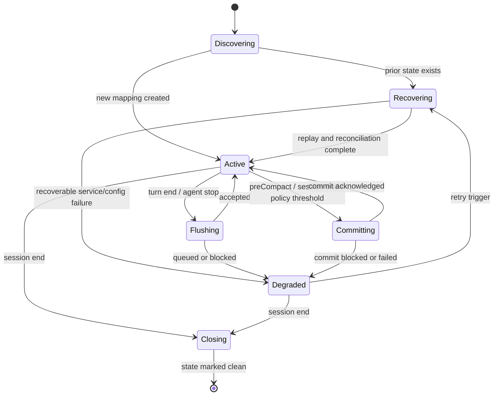

# Persistence and recovery

## 1. Invariants

1. Remote acceptance or durable local queueing happens before cursor advancement.
2. A commit never crosses an unsent or dead-lettered source record unless the
   exact dead-letter sequence was explicitly discarded and has a durable
   tombstone.
3. Local reconciliation and journal staging are idempotent. Remote delivery is
   at-least-once and **not** deduplicated: a probe posted the same
   `source_message_ids` twice and the session's `message_count` went from 1 to
   2, so a crash between remote acceptance and local cursor write can duplicate
   a remote message. Exactly-once delivery requires a server-side dedup key.
4. One Copilot session owns one state partition.
5. Competing extension/hook processes serialize mutation of a partition.
6. Authentication and validation failures are visible and do not retry forever.
7. OpenViking unavailability never makes the Copilot session unusable.

## 2. State layout

Default user state root:

```text
~/.openviking/copilot/
  state/
    <sha256-of-copilot-session-id>/
      state.json
      journal.ndjson
      observed-ids.ndjson
      dead-letter.ndjson
      discarded.ndjson
      lock/
  logs/
    adapter.log
```

The Phase 1 implementation hashes session IDs for directory names and stores
the original ID in `state.json`. The lock uses exclusive directory creation,
owner PID/token metadata, bounded waiting, and conservative stale-owner recovery.

### `state.json`

Fields: schema version, Copilot source session ID, highest durably observed
source sequence, highest remotely accepted source sequence, highest contiguous
resolved source sequence, and timestamps. The resolved cursor advances over
remote-accepted records and explicitly discarded sequences; it never implies a
discarded record was sent remotely. The OpenViking session ID is a deterministic
hash-derived mapping from the Copilot session ID; the effective peer is derived
from the workspace configuration and Git origin. Neither credential nor raw
workspace identity is stored in the journal.

`journal.ndjson` contains normalized records not yet remotely acknowledged.
`observed-ids.ndjson` stores only hashes of captured source event IDs and
payloads for transcript-boundary auditing. On initialization, missing entries
are reconstructed from still-pending or dead-lettered records; conflicting
digests fail explicitly. Records acknowledged and removed before this ledger
was introduced cannot be reconstructed retrospectively.

The ledger is bounded by the transcript, not by time. After a verified
compaction audit the hook prunes entries the current transcript no longer
mentions, because such an entry can never be consulted again; entries for still
pending or dead-lettered records are always kept so they stay resolvable. The
rewrite is atomic, so an interrupted prune leaves the previous ledger intact.
Without this a long session would grow one line per captured event with no
upper bound.
`dead-letter.ndjson` stores terminally rejected records and bounded failure
metadata. Dead-lettered sequence positions remain represented and block
acknowledgement beyond the gap. `discarded.ndjson` contains only sequence
numbers, a digest of the source event ID, a payload digest, and discard time;
it is the durable record that an operator intentionally omitted a message.

## 3. Write protocol

1. Normalize the source event and assign an ordinal among emitted records.
2. Deduplicate against pending source-event identities.
3. Append the record to the journal and fsync/close.
4. Append its source ID and payload digests to the observed ledger; if this
   step was interrupted, recover them from the unacknowledged journal.
5. Atomically advance the observed cursor.
6. Ensure the deterministic OpenViking session exists, then send messages in
   order.
7. On remote acceptance, atomically advance the acknowledged cursor and
   contiguous resolved cursor.
8. Compact the journal by atomic replace.
9. Commit only when no pending or dead-lettered record blocks the sequence.
   Explicitly discarded sequences may be crossed only because their tombstones
   are durable.

Transient send failures remain in the journal and are retried when the next
event, stop, or session-end hook runs. The live runtime also schedules a single
unreferenced timer per session, using exponential backoff from one second to a
15-second cap with ±20% jitter; timers are cancelled when the session ends.
Retry timing is process-local and restarts from the initial delay after reload.
A crash after OpenViking accepts a message but before the local acknowledged
cursor is persisted can cause that message to be sent again. The actual
OpenViking server's idempotency behavior in this window has not been verified;
do not promise exactly-once remote delivery. A synthetic offline restart test
verifies replay and commit ordering but not that server behavior.

State JSON files are written to a sibling temporary file and atomically renamed.
No in-place truncating writes are allowed.

## 4. Retry classification

| Failure | Action |
|---|---|
| Network interruption | Queue with exponential backoff and jitter |
| HTTP 408 | Retry |
| HTTP 429 | Retry with bounded backoff; `Retry-After` is not currently exposed by the shared HTTP helper |
| HTTP 5xx | Retry with bounded backoff |
| HTTP 401/403 | Stop automatic retries; surface credential error |
| HTTP 400/404/409/422 | Classify; dead-letter invalid records unless explicitly recoverable |
| Serialization/schema error | Dead-letter and mark adapter degraded |
| Local state I/O error | Stop capture for partition and surface high-priority diagnostic |

`src/retry-policy.mjs` classifies transport/no-status, 408, 429, 5xx, and
explicitly retryable 409 as retryable; 401/403 as authentication failures; and
other non-success HTTP statuses as terminal. The current runtime sends
sequentially and applies bounded retry scheduling to retryable failures;
the local diagnostics CLI can return a selected dead-letter sequence to the
pending queue with `retry --session <id> --sequence <n>`. This preserves the
record and sequence; the next capture flush retries it. Correct the underlying
configuration or transient server condition first. The operation does not edit
the payload or contact OpenViking.

Dead-letter records block commits beyond their sequence until the user retries,
explicitly discards, or exports them. A discard is a local, irreversible
conversation-data-loss operation and requires the `--confirm-data-loss` flag.
It permanently removes the queued payload and stores a digest-only tombstone.
The tombstone resolves that sequence gap but never represents a remote write;
later accepted records and commits can proceed past the intentionally omitted
record. Recovery exports retain tombstone metadata without retaining its
conversation content. The adapter never pretends a gap was remotely committed.
The local diagnostics command reports per-session queue counts and sequence
cursors without printing message payloads. An explicit recovery export includes
pending and dead-letter records; it refuses to overwrite an existing output and
must be handled as sensitive conversation data. Both commands are local-only.

## 5. Lease and concurrency

The SDK extension and configured hook may operate concurrently. Phase 1 state
operations coordinate with a per-session file lock:

- Lock acquisition uses exclusive directory creation.
- The owner records process ID, random ownership token, and acquisition time in
  an atomically renamed metadata file, so contenders cannot read partial JSON.
- After a 60-second stale threshold, a contender may recover the lock only when
  the recorded process no longer exists; recovery itself is serialized.
- Normal capture waits up to five seconds, then surfaces a lock error and leaves
  previously journaled work intact.
- `preCompact` receives priority but still obeys a hard deadline.

The implementation must not kill processes by name or perform broad cleanup.
Current tests also run competing worker processes against one session
partition; actual Copilot extension/hook interaction remains a host integration
gate.

## 6. State machine



## 7. Recovery scenarios
### Extension reload

- Reopen the session partition.
- Read event history from the accepted cursor.
- Re-normalize and deduplicate.
- Replay pending records before advancing.

### `/clear`

- Treat the old Copilot session as ending.
- Attempt bounded flush/commit.
- Persist an unclean marker if the deadline expires.
- Create a new OpenViking session for the new Copilot session.
- Do not reuse the old session solely because cwd/peer is unchanged.

### Resume

- If Copilot resumes the same source session ID, reuse its mapping.
- If the host creates a new ID with imported history, create a new mapping and
  store a predecessor reference after a host-contract experiment confirms this case.

### Transcript or event-history shrink

- Compare the stored history fingerprint and first/last identities.
- Never move durable cursors backward automatically.
- Use pending records and committed OpenViking state as authority.
- Mark a reconciliation warning if missing source history prevents proof.

### Crash or forced window close

- The unclean marker remains.
- The next extension startup replays pending records and reads event history.
- A commit occurs only after reconstructing a contiguous accepted prefix.

### Offline startup

- Session mapping can be created locally in provisional state.
- Recall and startup injection are skipped with one concise warning.
- Capture continues to the durable journal within configured limits.
- Remote session creation and replay occur after health recovery.

## 8. Queue limits

The adapter enforces configurable maximum bytes and record count:

- Warn at 70%.
- Pause automatic capture at 100%, preserving existing queued records.
- Never evict oldest conversation records silently.
- Offer an explicit export or discard operation for user-controlled recovery.

## 9. Commit policy

Commit triggers:

- mandatory before compaction;
- mandatory on session end;
- optional after a configured number of completed turns or elapsed time.

Commit acknowledgement means archive submission was accepted. Asynchronous memory
extraction completion is observed separately and must not be reported as immediate
memory availability.
